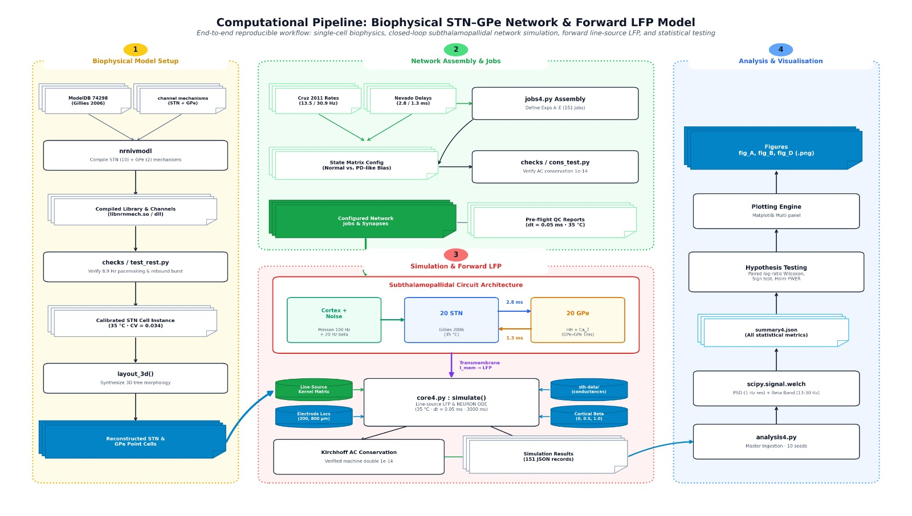
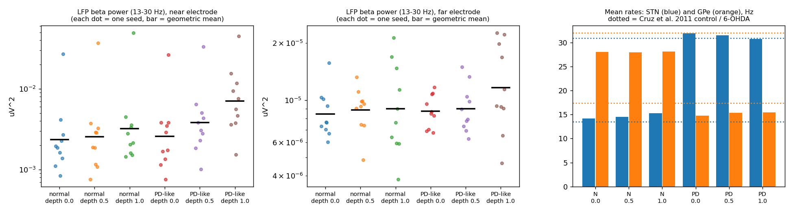
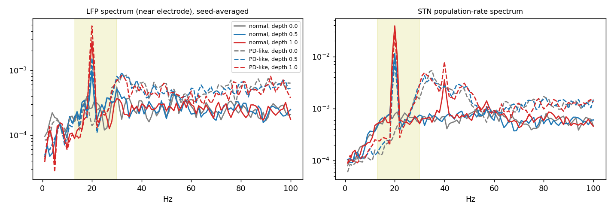
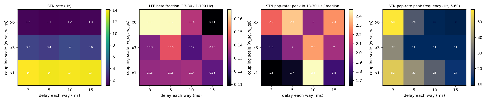
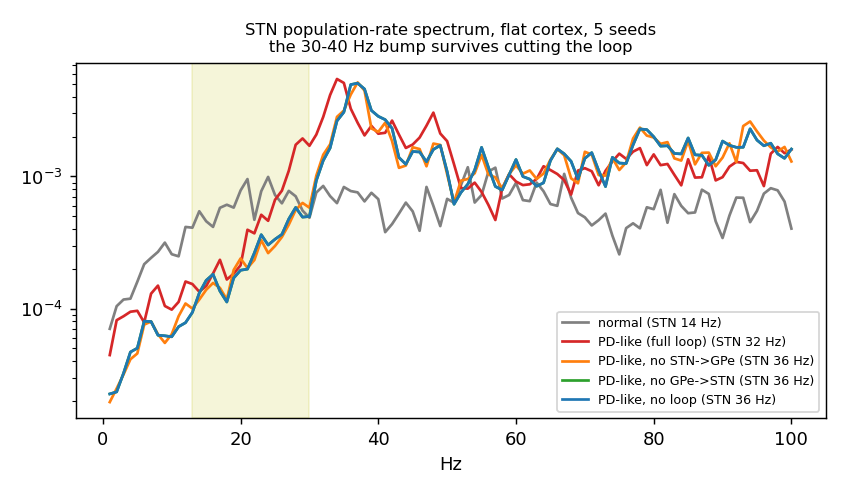

# STN–GPe network and LFP model (NEURON), normal vs Parkinson-like state

Course project, Computational Neuroscience (MSc Cognitive Science, Amrita Vishwa Vidyapeetham).
Authors: Utkarshini Mishra, Vidhu S Vijay and Arjun C.

A small network of 20 subthalamic nucleus (STN) neurons and 20 globus pallidus externus (GPe) neurons, simulated in NEURON at 35 °C, with the extracellular **local field potential (LFP)** computed from the membrane currents of the network's own STN cells. We ask which ingredient is needed for beta (13–30 Hz) power in the LFP: the firing-rate state, the STN–GPe loop, or rhythmic cortical input.



## What is in the model
- **STN cells:** the published rat STN projection neuron of Gillies & Willshaw (2006), ModelDB 74298. It fires on its own (about 9 Hz at 35 °C) and shows a rebound burst (`checks/`).
- **GPe cells:** a reduced Hodgkin–Huxley point cell with T-type calcium (`mods/gpehh.mod`, `mods/gpecat.mod`). This is **not** a published model.
- **Loop:** STN→GPe 2.8 ms and GPe→STN 1.3 ms (delays from the model of Nevado-Holgado et al. 2014), GPe→GPe 1.0 ms.
- **Input:** cortical Poisson input (100 Hz base) with optional 20 Hz modulation (depth 0, 0.5, 1.0), or background noise.
- **States:** normal (STN 14 Hz, GPe 28 Hz) and Parkinson-like (STN 32 Hz, GPe 15 Hz), set from the measured rates of Cruz et al. (2011): STN 13.5 → 30.9 Hz, GPe 32.0 → 17.4 Hz.
- **LFP:** line-source approximation with fast `i_membrane_`, σ = 0.3 S/m, two electrodes at 200 µm (near) and 800 µm (far). The kernel was checked against LFPy in an earlier version, and current conservation is checked in every run.
- **Statistics:** log power, paired two-sided Wilcoxon and sign tests, Holm correction, 10 seeds.

## Experiments (151 runs)
| | What | Runs |
|---|---|---|
| A | Loop only: delay 3/5/10/15 ms × coupling ×1/×3/×6, cortex off | 24 |
| B | State (normal, Parkinson-like) × cortical beta depth (0, 0.5, 1.0), 10 seeds | 60 |
| C | What makes the 45–60 Hz LFP peak: change GPe rate, cut loop limbs | 12 |
| D | Is the 30–40 Hz bump a loop rhythm: cut loop limbs in the Parkinson-like state | 15 |
| E | Firing-rate drive vs GPe–GPe coupling: cross the two, 10 seeds | 40 |

## Main findings (near electrode, Holm-corrected)
- The Parkinson-like state alone makes **no extra LFP beta** (×1.10, not significant).
- The STN–GPe loop alone makes no beta at literature delays; stronger coupling silences the STN.
- With 20 Hz cortical input, the Parkinson-like state responds about **2× more** (×2.22 at depth 1.0, Holm p = 0.049; far electrode: nothing significant).
- **Experiment E:** this gain follows the firing-rate drive (×2.2, Holm p = 0.010 and 0.023) and not the GPe–GPe coupling (×0.92, Holm p = 0.55).
- The 45–62 Hz LFP peak is not fixed at 49 Hz and survives cutting the loop. The 30–40 Hz bump follows the cells' own firing rate and is not a network rhythm.






## Limitations
- The GPe is not a published model, and its rates are 12–15 % below the measured ones.
- Only the cell is published, not the network. Wiring, synapse sizes and locations are our choices.
- The size of the Parkinson-like changes is an assumption (the literature gives the direction).
- "Drive" in experiment E changes STN and GPe settings together, and firing rate cannot be separated from the cell state that sets it.
- No Parkinsonian bursting (the STN is more regular in the Parkinson-like state), no STN–STN connections, no striatal input, and cortical beta is a sinusoidal modulation.
- The 3-D branch directions of the dendrites are invented (the published model has only lengths and diameters).
- Small network (20 + 20 cells). Experiments A and C have 2 seeds and are descriptive. The 30–40 Hz tests in D were chosen after looking at the spectra.
- GABA-only / AMPA-only tests and a phase-randomised cortex control were not run.
- Nothing was compared with real LFP recordings.
- This is a model result and not a claim about patients. We do not claim a new mechanism.

## How to run
Tested with **NEURON 9.0.2 on Linux**. The code loads `mods/x86_64/libnrnmech.so`, so on Windows you will need to compile the mod files with `mknrndll` and change the path in `core4.py`.

```
pip install -r requirements.txt
cd mods && nrnivmodl && cd ..        # compile the channel files (core4.py also tries this)
jupyter notebook updated_work_v4.ipynb
```
All results are already saved in `results/`, so the notebook shows everything without rerunning. To recompute missing runs set `RUN_SIMS = True` in the notebook (about 160 s per run). The first notebook cell unzips the package when used in Colab.

## Files
| | |
|---|---|
| `core4.py` | network, LFP and analysis functions |
| `jobs4.py` | the two states and experiments A–E |
| `run_exp4.py`, `run_E.sh` | experiment runner |
| `analysis4.py`, `analysis_E.py` | statistics and figures |
| `updated_work_v4.ipynb` | the notebook with all results |
| `results/` | saved simulation results (JSON) |
| `summary4.json` | statistics |
| `checks/` | tests of the published cell, rebound burst and current conservation |
| `mods/`, `sth-data/`, `SThprotocell.hoc` | channel files and data of ModelDB 74298 (and our two GPe files) |
| `CHANGES4.md` | what changed from version 3 and what is not done |

## Credits and references
The STN cell files (`mods/` except `gpehh.mod` and `gpecat.mod`, `sth-data/`, `SThprotocell.hoc`) are from ModelDB 74298 and belong to their authors. See `README_ModelDB_original.txt`.

- Gillies A, Willshaw D (2006). Rat subthalamic nucleus projection neuron model. J Neurophysiol 95:2352–2365. ModelDB 74298.
- Cruz AV, Mallet N, Magill PJ, Brown P, Averbeck BB (2011). Effects of dopamine depletion on information flow between the subthalamic nucleus and external globus pallidus. J Neurophysiol 106(4):2012–2023. doi:10.1152/jn.00094.2011.
- Nevado-Holgado AJ, Mallet N, Magill PJ, Bogacz R (2014). Effective connectivity of the subthalamic nucleus–globus pallidus network during Parkinsonian oscillations. J Physiol.
- Terman D, Rubin JE, Yew AC, Wilson CJ (2002). Activity patterns in a model for the subthalamopallidal network of the basal ganglia. J Neurosci.
- Parasuram H, et al. (2016). Computational modeling of single neuron extracellular electric potentials and network local field potentials using LFPsim. Front Comput Neurosci 10. doi:10.3389/fncom.2016.00065.
- Lindén H, et al. (2014). LFPy: a tool for biophysical simulation of extracellular potentials generated by detailed model neurons. Front Neuroinform 7:41.
- Hagen E, et al. (2016). Hybrid scheme for modeling local field potentials from point-neuron networks. Cerebral Cortex.
- Holt GR, Koch C (1999). Electrical interactions via the extracellular potential near cell bodies. J Comput Neurosci.
